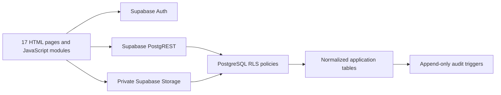
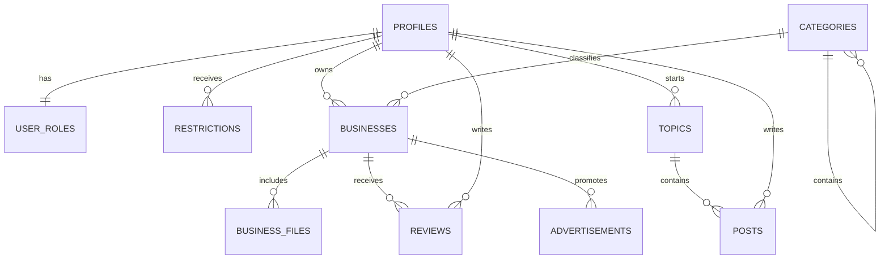

# Architecture and security

Every application table enables RLS. Public queries expose approved content, category names and public settings. Profiles and role assignments are private to the member and authorized staff. `user_roles` and `role_permissions` are checked in the database, so changes apply immediately rather than waiting for token refresh.

Members own their contributions. Non-staff edits return content to pending; changing listing files also returns the listing to review. Ownership identifiers cannot be reassigned. Restriction checks use server time and support expiry and revocation. Administrator accounts cannot be restricted.

Files use a private bucket with a 10 MB limit and an allowlist of JPEG, PNG, WebP and PDF types. Storage paths bind the uploader and business. Approved files can be downloaded with short-lived signed URLs. Signed links already issued remain usable until they expire. Client upload validation improves feedback; storage policies enforce ownership and access independently.

Audit records are written by database triggers and cannot be inserted, updated or deleted by browser users. The log stores actor, action, entity, timestamp and status rather than copies of private profile content.

The `directory_entries` view uses security-invoker behavior and aggregates approved review ratings. Full-text search uses an indexed generated search vector. Other indexes cover owner, category, location, content status and foreign-key lookup paths.
